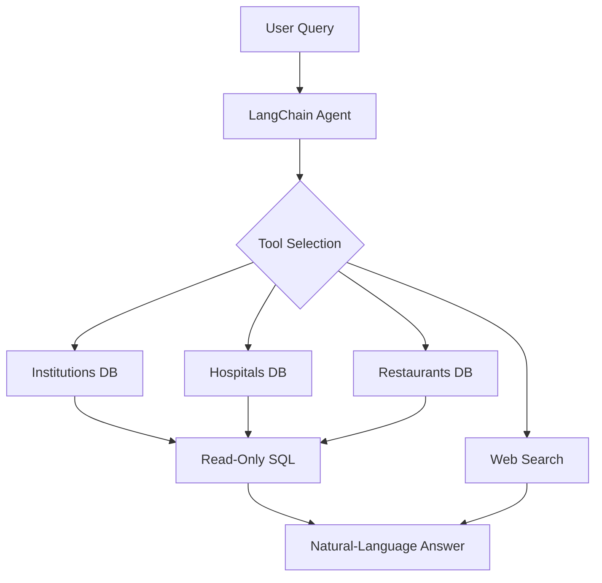

<div align="center">

## 🇧🇩 Bangladesh Multi-Domain Intelligent AI Agent</h3>

**One AI agent. Three Bangladesh-focused databases. Real-time web search.**

Built with **LangChain**, **OpenRouter**, and **SQLite**.

</div>

---

## ✨ Features

- 🏫 **Institutions** — schools, colleges, universities, and government institutions.
- 🏥 **Hospitals** — hospitals, clinics, and health complexes.
- 🍽️ **Restaurants** — locations, ratings, and reviews.
- 🌐 **Web Search** — general knowledge and policy-related questions.
- 🤖 **Smart Routing** — selects the relevant tool for each query.

## 📁 Datasets

| Dataset | Records | Coverage |
|---|---:|---|
| [Institutional Information of Bangladesh](https://huggingface.co/datasets/Mahadih534/Institutional-Information-of-Bangladesh) | 34,901 | Institutions, locations, EIIN |
| [All Bangladeshi Hospitals](https://huggingface.co/datasets/Mahadih534/all-bangladeshi-hospitals) | 38,886 | Hospitals, clinics, facilities |
| [Bangladeshi Restaurant Data](https://huggingface.co/datasets/Mahadih534/Bangladeshi-Restaurant-Data) | 12,703 | Restaurants, ratings, addresses |

## 🏗️ Architecture



## 📂 Project Structure

```text
├── data/
│   ├── institutions.csv
│   ├── hospitals.csv
│   └── restaurants.csv
├── databases/
│   ├── institutions.db
│   ├── hospitals.db
│   └── restaurants.db
├── tools/
│   ├── database_utils.py
│   ├── institutions_tool.py
│   ├── hospitals_tool.py
│   ├── restaurants_tool.py
│   └── web_search_tool.py
├── convert_datasets.py
├── main.py
├── requirements.txt
└── README.md
```

## ⚙️ Setup

### 1. Clone the repository

```bash
git clone <your-repo-url>
cd <repository-folder>
```

### 2. Create a virtual environment

**Windows (PowerShell)**

```powershell
python -m venv .venv
.\.venv\Scripts\Activate.ps1
```

**Linux / macOS**

```bash
python3 -m venv .venv
source .venv/bin/activate
```

### 3. Install dependencies

```bash
pip install -r requirements.txt
```

### 4. Configure `.env`

```env
OPENROUTER_API_KEY=your_openrouter_api_key
TAVILY_API_KEY=your_tavily_api_key
```

*Set `TAVILY_API_KEY` only if your web-search configuration uses Tavily.*

### 5. Build the databases

Place the CSV files in `data/`, then run:

```bash
python convert_datasets.py
```

## 🚀 Run

| Mode | Command |
|---|---|
| Demo / verification | `python main.py` |
| Interactive chat | `python main.py --chat` |

### Python usage

```python
from main import build_agent_executor

agent = build_agent_executor(verbose=True)

result = agent.invoke({
    "input": "Give me 3 colleges in Barisal division."
})

print(result["output"])
```

## 🔎 Example Queries

| Query | Tool |
|---|---|
| How many hospitals are listed in Dhaka? | `HospitalsDBTool` |
| Give me 3 colleges in Barisal division. | `InstitutionsDBTool` |
| Show highly rated restaurants in Dhaka. | `RestaurantsDBTool` |
| What is the current policy on a public service? | `WebSearchTool` |

---

<div align="center">

**Built for Bangladesh 🇧🇩**

</div>
"""

output_path = "/mnt/data/README.md"
pypandoc.convert_text(readme, "md", format="md", outputfile=output_path, extra_args=["--standalone"])
print(f"Created redesigned README at {output_path}")
