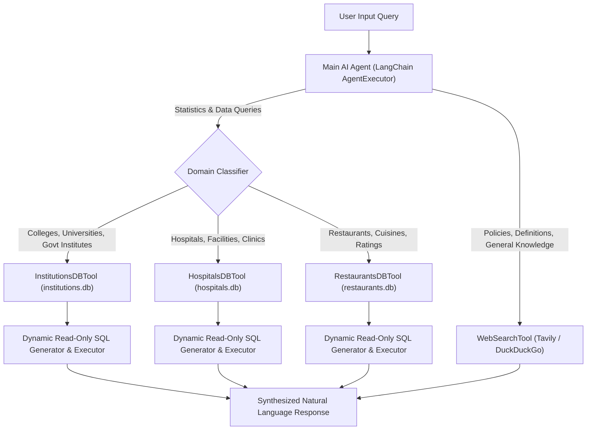

# 🇧🇩 Bangladesh Multi-Domain Intelligent AI Agent

An autonomous AI Agent built with **LangChain** and **OpenRouter** that routes data-specific queries to three dedicated SQLite databases (Institutions, Hospitals, Restaurants in Bangladesh) and general knowledge/policy queries to a real-time **Web Search Tool**.

---

## 📁 Provided Datasets

The agent is powered by three curated Bangladesh datasets from Hugging Face:

1. **Institutional Information of Bangladesh**  
   🔗 [Mahadih534/Institutional-Information-of-Bangladesh](https://huggingface.co/datasets/Mahadih534/Institutional-Information-of-Bangladesh)  
   *34,901 records* of universities, colleges, schools, government institutions, locations, and EIIN numbers.
2. **All Bangladeshi Hospitals**  
   🔗 [Mahadih534/all-bangladeshi-hospitals](https://huggingface.co/datasets/Mahadih534/all-bangladeshi-hospitals)  
   *38,886 records* of hospitals, clinics, upazila health complexes, divisions, and public/private status.
3. **Bangladeshi Restaurant Data**  
   🔗 [Mahadih534/Bangladeshi-Restaurant-Data](https://huggingface.co/datasets/Mahadih534/Bangladeshi-Restaurant-Data)  
   *12,703 records* of restaurants, ratings, reviews count, affluence, and addresses across Bangladesh.

---

## 🛠️ Architecture & Workflow

The system uses a **LangChain AgentExecutor** with dynamic tool calling. When a user submits a query, the agent analyzes its semantic intent:
- **Data/Statistics queries** are routed to the corresponding SQLite database tool.
- **General knowledge / Policy queries** are routed to the web search tool.



---

## 📂 Project Structure

```text
├── data/
│   ├── institutions.csv        # Raw dataset from Hugging Face
│   ├── hospitals.csv           # Raw dataset from Hugging Face
│   └── restaurants.csv         # Raw dataset from Hugging Face
├── databases/
│   ├── institutions.db         # SQLite DB (table: institutions)
│   ├── hospitals.db            # SQLite DB (table: hospitals)
│   └── restaurants.db          # SQLite DB (table: restaurants)
├── tools/
│   ├── __init__.py             # Exports all tools
│   ├── database_utils.py       # Reusable SQL generator, validator & runner
│   ├── institutions_tool.py    # InstitutionsDBTool
│   ├── hospitals_tool.py       # HospitalsDBTool
│   ├── restaurants_tool.py     # RestaurantsDBTool
│   └── web_search_tool.py      # WebSearchTool (Tavily + DuckDuckGo fallback)
├── convert_datasets.py         # ETL script: CSVs -> SQLite DBs with clean schemas
├── main.py                     # Main AgentExecutor, demo suite & interactive CLI
├── requirements.txt            # Python dependencies
├── .env.example                # Template for environment variables
└── README.md                   # Project documentation
```

---

## ⚙️ Installation & Setup

### 1. Clone the Repository
```bash
git clone <your-repo-url>
cd Projects
```

### 2. Create and Activate Virtual Environment
```bash
# Windows (PowerShell)
python -m venv .venv
.venv\Scripts\Activate.ps1

# Linux / macOS
python3 -m venv .venv
source .venv/bin/activate
```

### 3. Install Dependencies
```bash
pip install -r requirements.txt
```

### 4. Configure Environment Variables
Copy `.env.example` to `.env` and configure your API keys:
```bash
cp .env.example .env
```
Edit `.env`:
```env
OPENROUTER_API_KEY=your_openrouter_api_key_here

# Optional: Tavily API Key (DuckDuckGo is used automatically if omitted)
TAVILY_API_KEY=your_tavily_key_here
```

### 5. Convert CSVs to SQLite DBs (If not already built)
```bash
python convert_datasets.py
```

---

## 🚀 Running the Agent

### A. Run Automated Verification / Demo Mode
Executes a demonstration suite covering all three databases and general web search queries:
```bash
python main.py
```

### B. Run Interactive Chat Mode
Start a real-time conversational session with the agent:
```bash
python main.py --chat
```

### C. Programmatic Python Usage
```python
from main import build_agent_executor

agent = build_agent_executor(verbose=True)

# 🧮 1. Database Query (Hospitals)
result1 = agent.invoke({"input": "How many hospitals are in Dhaka?"})
print(result1["output"])

# 🧮 2. Database Query (Institutions)
result2 = agent.invoke({"input": "Give me 3 colleges in Chittagong division."})
print(result2["output"])

# 🧮 3. Database Query (Restaurants)
result3 = agent.invoke({"input": "What are 3 top-rated restaurants in Dhaka?"})
print(result3["output"])

# 🌐 4. Web Search Query (General Knowledge & Policy)
result4 = agent.invoke({"input": "What is the role of DGHS in Bangladesh?"})
print(result4["output"])

result5 = agent.invoke({"input": "What is the healthcare policy in Bangladesh?"})
print(result5["output"])
```

---

## 🔍 Verified Example Queries & Outputs

| Query | Routed Tool | Output Summary |
| :--- | :--- | :--- |
| **"How many hospitals are in Dhaka?"** | `HospitalsDBTool` | Verified: `9,876 hospitals` found in Dhaka district. |
| **"Give me 3 colleges in Chittagong division"** | `InstitutionsDBTool` | Returns 3 verified colleges (e.g., Bandarban Govt. Women College, etc.). |
| **"What are 3 top-rated restaurants in Dhaka?"** | `RestaurantsDBTool` | Returns top 5.0 rated dining establishments. |
| **"What is the role of DGHS in Bangladesh?"** | `WebSearchTool` | Explains DGHS as the Directorate General of Health Services under MOHFW. |
| **"What is the healthcare policy in Bangladesh?"** | `WebSearchTool` | Synthesizes National Health Policy, 4th/5th HPNSP, and reform initiatives. |

---

## 🛡️ Security & Safety Guards
- **Read-Only SQLite**: Database connections use SQLite `?mode=ro` and `PRAGMA query_only = ON`.
- **SQL Sanitization**: Generated queries are strictly checked: only single `SELECT` statements are allowed. Any `DROP`, `DELETE`, `UPDATE`, `INSERT`, `ATTACH`, comments (`--`, `/*`), or multi-statements (`;`) are rejected before execution.
- **Failover Search**: `WebSearchTool` automatically falls back to DuckDuckGo search if no Tavily API key is provided, preventing runtime crashes.
